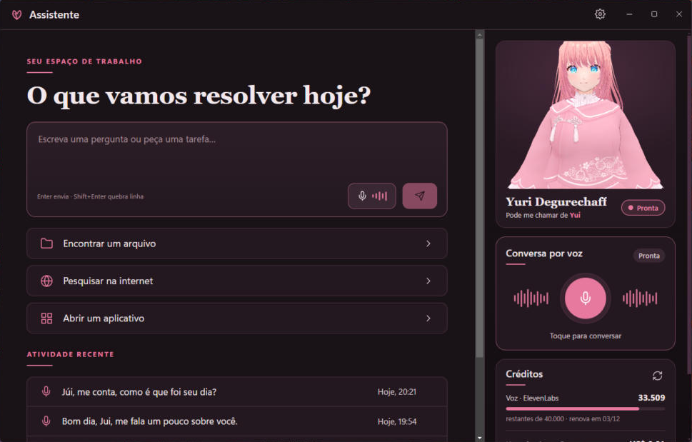

<div align="center">

# Assistente Yui ♡

**Your virtual little sister on your PC.**

Chat by text or voice with **Yui**, a playful little sister who answers with her own voice, remembers what you tell
her, appears in 3D changing expressions, and helps you use your computer. The app speaks Brazilian Portuguese.

[Português](README.md) · **English**

[](https://github.com/Maidzinha/assistente-yui/releases/latest)


[](LICENSE)



</div>

## Download

Go to **[Releases → latest version](https://github.com/Maidzinha/assistente-yui/releases/latest)** and download
**`Assistente-Yui-Instalador-<version>.exe`**. To check the download, compare the file's SHA-256 with the release's `SHA256SUMS.txt`.

**Requirements:** Windows 10 or 11, 64-bit, and an internet connection (the AI and the voice run in the cloud). You
need two API keys, from **your own** accounts:

| Service | What for | Cost |
|---|---|---|
| [Groq](https://console.groq.com) | Yui's AI and recognizing your voice | Free plan available (with a per-minute limit); paid usage costs cents |
| [ElevenLabs](https://elevenlabs.io) | Yui's voice | Free plan with monthly credits |

> **"Windows protected your PC"?** This SmartScreen warning appears because the app has no commercial code signature.
> Click **More info → Run anyway**. If Windows **Smart App Control** is on, it may block the installed app; in that
> case, see [Building from source](#building-from-source).

## What's new in 0.3.0

- ✨ **New look:** Yui lives on a large stage next to the conversation, with a side navigation rail and a centered home screen.
- 👀 **A livelier Yui:** her eyes and head follow the mouse, and you can rotate, zoom and pick the framing.
- 🎚️ **Microphone modes:** tap to talk, open microphone or push to talk, in their own settings tab.
- ⌨️ **Keyboard shortcuts** and a collapsible credits panel.

The full list is in the [changelog](docs/en/CHANGELOG.md).

## How to use

1. Install and open **Assistente Yui**.
2. In **Configurações** (Settings, the gear on the side rail), **Modelo de IA** tab: choose "compatível com OpenAI",
   URL `https://api.groq.com/openai/v1`, model `openai/gpt-oss-20b`, and paste your Groq key.
3. **Voz** tab:
   - under **Reconhecimento de fala**, choose "compatível com OpenAI", the same Groq address and model `whisper-large-v3-turbo`;
   - under **Voz da Yui**, choose **ElevenLabs**, paste your key and the **Voice ID** of the voice you want (it can be your own cloned voice).
4. **Microfone** tab: choose how you want to talk to her (see [Microphone modes](#microphone-modes)).
5. **Aparência** tab: import a **`.vrm`** model (made in [VRoid Studio](https://vroid.com/en/studio), for example) to see Yui in 3D.
   Without a model, she appears in 2D.
6. Tap the **microphone** and talk, or type in the text box.

The **Créditos** panel, below Yui, shows how much you have left on ElevenLabs and how much you spent on Groq this month. Click it for details.

## What she does

- 🎙️ **Voice chat:** you talk, she understands and answers out loud, sentence by sentence (she starts before the answer is finished).
- 💬 **Emotional voice:** with ElevenLabs v3/v4 models, Yui laughs, sighs or whispers only when it fits; by default she speaks normally.
- 🧠 **Memory:** remembers the important things you tell her (never sensitive data). You can view and delete them in Settings → Memória.
- 💖 **Personality:** a laid-back little sister who jokes and sometimes teases you, always affectionately.
- 🧍‍♀️ **Yui in 3D:** blinks, breathes, moves her mouth with her voice, changes expression (happy, sad, surprised, angry, relaxed)
  and follows the mouse with her eyes.
- 📊 **Credits:** ElevenLabs characters left, plus Groq's monthly spend and requests left today.
- 🗂️ **PC help:** finds files and opens folders, documents, apps and websites.

## Microphone modes

Pick one in **Configurações → Microfone**, or click the mode name under the microphone button.

| Mode | How it works | Good for |
|---|---|---|
| **Tocar para falar** (tap to talk) | Tap the microphone to start. She sends when you stop talking. | Everyday use |
| **Microfone livre** (open microphone) | Once on, it keeps listening: just talk. She answers and listens again on her own. | Hands-free chatting |
| **Apertar para falar** (push to talk) | Records only while you hold a key (F2 by default) and sends when you release it. | Noisy rooms |

The same tab has the **sensitivity** (if she misses a quiet voice or picks up too much noise) and the **pause before sending**
(how much silence she waits for before deciding you are done). Push to talk works while Yui's window is in the foreground;
the available keys are F2, F4, F8, F9, right Ctrl, Insert and Pause.

## 3D controls

| Action | What it does |
|---|---|
| Move the mouse | She follows it with her eyes and head |
| Drag on her | Rotates the camera |
| Mouse wheel on her | Zooms in or out |
| Double-click | Back to the default framing |
| **Rosto / Busto / Corpo** buttons | Ready-made framings: face, bust, body (shown when you hover over her) |

## Keyboard shortcuts

| Shortcut | What it does |
|---|---|
| `Enter` | Sends the message (`Shift+Enter` adds a line break) |
| `Ctrl+N` | New conversation |
| `Ctrl+,` | Opens the settings |
| `Ctrl+B` | Shows or hides Yui, to focus on the conversation |
| `F2` (hold) | Talk, in push-to-talk mode |

## Security and privacy

- **API keys** are encrypted by Windows (DPAPI) on your PC and never go into the code.
- The **microphone** only turns on after you start the voice chat, and audio is not kept on your PC (temporary files are deleted right after use).
  With the open microphone it stays on until you end the chat or mute it in the voice panel.
- PC actions follow a **closed list**. Anything that changes files or opens websites **asks for confirmation**; terminal,
  registry, installing programs and system folders are **blocked**.
- What you say and type is sent to Groq and ElevenLabs to generate the answers, under each service's terms.

## License

Assistente Yui is licensed under the **[PolyForm Noncommercial License 1.0.0](LICENSE)**.

- ✅ **For any noncommercial purpose you may:** use, study and modify it, build new works on it, and share copies, with
  or without changes. This covers personal use, study, hobbies, and schools, charities and public institutions.
- 📄 **Required:** anyone who gets a copy from you must also get the license and the line
  `Required Notice: Copyright (c) 2026 Helder (Maidzinha) (https://github.com/Maidzinha/assistente-yui)`.
- ❌ **You may not:** use it commercially (sell it, charge for access, use it in a paid product or service or at a
  for-profit company) or sublicense it. For commercial use, contact the author.

The license covers the code: it does not allow presenting another project as the official Assistente Yui.
Third-party components (Electron, React, three.js, three-vrm…) keep their own licenses: see [THIRD-PARTY-NOTICES.md](THIRD-PARTY-NOTICES.md).

## Building from source

Building and modifying it is allowed for noncommercial purposes (see the [license](LICENSE)). You need
[Node.js 20+](https://nodejs.org) on Windows.

```bash
git clone https://github.com/Maidzinha/assistente-yui.git
```

```bash
cd assistente-yui
```

```bash
npm install
```

```bash
npm run dev
```

Other commands: `npm run build` (builds into `out/`), `npm run typecheck` and `npm run dist` (creates the installer in `release/`).

If Windows blocks the installed app, run `npm run build` and open it through the project's Electron with a shortcut to
`node_modules\electron\dist\electron.exe "<project folder>"`.

## Changelog

What changed in each version is in the [changelog](docs/en/CHANGELOG.md).

---

<div align="center"><sub>Assistente Yui — Personal Edition · © 2026 Helder (Maidzinha) · PolyForm Noncommercial 1.0.0 ♡</sub></div>
