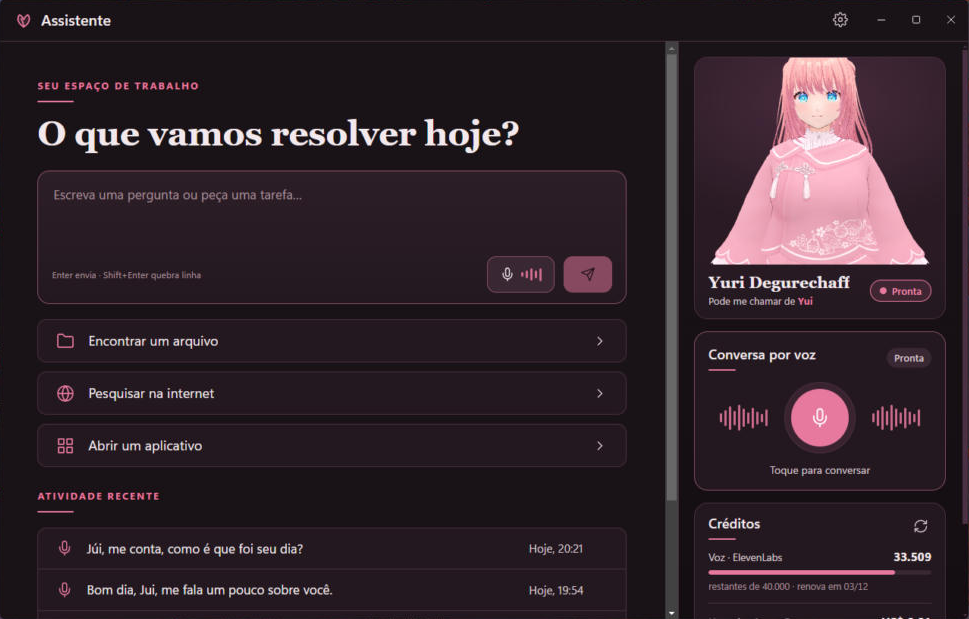

<div align="center">

# Assistente Yui ♡

**Sua irmãzinha virtual no PC.**

Converse por texto ou por voz com a **Yui**, uma irmãzinha brincalhona que responde com voz própria, lembra do que
você conta, aparece em 3D mudando de expressão e ainda ajuda a usar o computador. Em português (Brasil).

**Português** · [English](README.en.md)

[](https://github.com/Maidzinha/assistente-yui/releases/latest)


[](LICENSE)



</div>

## Baixar

Vá em **[Releases → última versão](https://github.com/Maidzinha/assistente-yui/releases/latest)** e baixe o
**`Assistente-Yui-Instalador-<versão>.exe`**. Para conferir o download, compare o SHA-256 do arquivo com o `SHA256SUMS.txt` da release.

**Requisitos:** Windows 10 ou 11, 64 bits, e internet (a IA e a voz rodam na nuvem). Você vai precisar de duas
chaves de API, das contas **suas**:

| Serviço | Para quê | Custo |
|---|---|---|
| [Groq](https://console.groq.com) | IA da Yui e reconhecimento da sua voz | Tem plano gratuito (com limite por minuto); o pago custa centavos |
| [ElevenLabs](https://elevenlabs.io) | A voz da Yui | Tem plano gratuito com créditos mensais |

> **"O Windows protegeu o computador"?** Esse aviso do SmartScreen aparece porque o app não tem assinatura digital comercial.
> Clique em **Mais informações → Executar assim mesmo**. Se o **Controle Inteligente de Aplicativos** do Windows estiver
> ligado, ele pode bloquear o app instalado; nesse caso, veja [Compilar a partir do código](#compilar-a-partir-do-código).

## Novidades da versão 0.3.0

- ✨ **Visual novo:** a Yui fica em um palco grande ao lado da conversa, com barra de navegação lateral e tela inicial centralizada.
- 👀 **Yui mais viva:** o olhar e a cabeça acompanham o mouse, e dá para girar, aproximar e escolher o enquadramento.
- 🎚️ **Modos do microfone:** tocar para falar, microfone livre ou apertar para falar, em uma aba própria das configurações.
- ⌨️ **Atalhos de teclado** e painel de créditos recolhível.

A lista completa está no [CHANGELOG.md](CHANGELOG.md).

## Como usar

1. Instale e abra o **Assistente Yui**.
2. Em **Configurações** (engrenagem na barra lateral), aba **Modelo de IA**: escolha "compatível com OpenAI",
   URL `https://api.groq.com/openai/v1`, modelo `openai/gpt-oss-20b` e cole a chave da Groq.
3. Aba **Voz**:
   - em **Reconhecimento de fala**, escolha "compatível com OpenAI", o mesmo endereço da Groq e o modelo `whisper-large-v3-turbo`;
   - em **Voz da Yui**, escolha **ElevenLabs**, cole a chave e o **Voice ID** da voz que você quer (pode ser uma voz clonada sua).
4. Aba **Microfone**: escolha como quer falar com ela (veja [Modos do microfone](#modos-do-microfone)).
5. Aba **Aparência**: importe um modelo **`.vrm`** (feito no [VRoid Studio](https://vroid.com/studio), por exemplo) para ver a Yui em 3D.
   Sem modelo, ela aparece em 2D.
6. Toque no **microfone** e converse, ou escreva na caixa de texto.

O painel **Créditos**, embaixo da Yui, mostra quanto ainda resta na ElevenLabs e quanto você gastou na Groq no mês. Clique nele para ver os detalhes.

## O que ela faz

- 🎙️ **Conversa por voz:** você fala, ela entende e responde falando, frase a frase (começa antes de terminar a resposta).
- 💬 **Voz com emoção:** nos modelos v3/v4 da ElevenLabs, a Yui ri, suspira ou fala baixinho só quando faz sentido; o padrão é falar normal.
- 🧠 **Memória:** lembra das coisas importantes que você conta (nunca dados sensíveis). Dá para ver e apagar em Configurações → Memória.
- 💖 **Personalidade:** irmãzinha descontraída, faz piadas e às vezes te zoa, sempre com carinho.
- 🧍‍♀️ **Yui em 3D:** pisca, respira, mexe a boca com a voz, muda de expressão (feliz, triste, surpresa, brava, relaxada)
  e acompanha o mouse com o olhar.
- 📊 **Créditos:** caracteres restantes da ElevenLabs, gasto do mês e pedidos restantes do dia na Groq.
- 🗂️ **Ajuda no PC:** encontra arquivos, abre pastas, documentos, aplicativos e sites.

## Modos do microfone

Escolha em **Configurações → Microfone**, ou clique no nome do modo embaixo do botão do microfone.

| Modo | Como funciona | Bom para |
|---|---|---|
| **Tocar para falar** | Você toca no microfone para começar. Ela envia quando você para de falar. | O dia a dia |
| **Microfone livre** | Depois de ligado, fica sempre ouvindo: é só falar. Ela responde e volta a ouvir sozinha. | Conversar sem usar as mãos |
| **Apertar para falar** | Grava só enquanto você segura uma tecla (F2 por padrão) e envia quando você solta. | Ambientes com barulho |

Na mesma aba dá para ajustar a **sensibilidade** (se ela não ouve voz baixa ou capta barulho demais) e a **pausa para enviar**
(quanto silêncio ela espera até entender que você terminou). O apertar para falar funciona com a janela da Yui em primeiro plano;
as teclas disponíveis são F2, F4, F8, F9, Ctrl direito, Insert e Pause.

## Controles da Yui em 3D

| Ação | O que faz |
|---|---|
| Mover o mouse | Ela acompanha com o olhar e a cabeça |
| Arrastar sobre ela | Gira a câmera |
| Roda do mouse sobre ela | Aproxima ou afasta |
| Dois cliques | Volta ao enquadramento padrão |
| Botões **Rosto / Busto / Corpo** | Enquadramentos prontos (aparecem ao passar o mouse sobre ela) |

## Atalhos de teclado

| Atalho | O que faz |
|---|---|
| `Enter` | Envia a mensagem (`Shift+Enter` quebra a linha) |
| `Ctrl+N` | Nova conversa |
| `Ctrl+,` | Abre as configurações |
| `Ctrl+B` | Mostra ou esconde a Yui, para focar na conversa |
| `F2` (segurar) | Fala, no modo apertar para falar |

## Segurança e privacidade

- As **chaves de API** ficam cifradas pelo Windows (DPAPI) no seu PC e nunca vão para o código.
- O **microfone** só liga depois que você inicia a conversa por voz, e o áudio não fica salvo no PC (arquivos temporários são apagados logo após o uso).
  No microfone livre ele fica ligado até você encerrar ou silenciar pelo painel de voz.
- As ações no PC seguem uma **lista fechada**. O que muda arquivos ou abre sites **pede confirmação**; terminal,
  registro, instalação de programas e pastas do sistema são **bloqueados**.
- O que você fala e escreve vai para a Groq e para a ElevenLabs para gerar as respostas, conforme os termos de cada serviço.

## Licença

O Assistente Yui usa a **[PolyForm Noncommercial License 1.0.0](LICENSE)** (texto oficial em inglês;
[resumo em português](LICENSE.pt.md)).

- ✅ **Pode, sem fins comerciais:** usar, estudar, modificar, criar trabalhos a partir dele e compartilhar cópias,
  com ou sem modificações. Vale para uso pessoal, estudo, hobby e para escolas, ONGs e órgãos públicos.
- 📄 **Obrigatório:** quem receber uma cópia sua precisa receber junto a licença e a linha
  `Required Notice: Copyright (c) 2026 Helder (Maidzinha) (https://github.com/Maidzinha/assistente-yui)`.
- ❌ **Não pode:** usar comercialmente (vender, cobrar acesso, usar em produto ou serviço pago ou em empresa com fins
  lucrativos) nem sublicenciar. Para uso comercial, fale com o autor.

A licença cobre o código: ela não autoriza apresentar outro projeto como se fosse o Assistente Yui oficial.
Os componentes de terceiros (Electron, React, three.js, three-vrm…) continuam com as licenças deles: veja [THIRD-PARTY-NOTICES.md](THIRD-PARTY-NOTICES.md).

## Compilar a partir do código

Compilar e modificar é permitido para fins não comerciais (veja a [licença](LICENSE)). É preciso o
[Node.js 20+](https://nodejs.org) no Windows.

```bash
git clone https://github.com/Maidzinha/assistente-yui.git
```

```bash
cd assistente-yui
```

```bash
npm install
```

```bash
npm run dev
```

Outros comandos: `npm run build` (compila em `out/`), `npm run typecheck` e `npm run dist` (gera o instalador em `release/`).

### Ativação (chave de licença)

A Yui só abre com uma chave ativa, emitida pelo **Maidzinha License Manager** (aplicativo `ASSISTENTE-YUI`).
Antes de compilar, copie `.env.example` para `.env.local` e preencha o endereço da API e a chave de API do app
(no License Manager: **Aplicativos → Assistente Yui**). O `.env.local` não vai para o Git.

- Na primeira abertura ela pede a chave e ativa este PC (o limite de computadores vem do painel).
- A licença é conferida de novo a cada abertura e a cada 30 minutos; as respostas do servidor são assinadas (HMAC-SHA256 + nonce).
- Sem internet, continua funcionando por até 3 dias desde a última verificação.
- Para trocar de PC: **Configurações → Licença → Desativar neste PC**.

Se o Windows bloquear o app instalado, rode `npm run build` e abra pelo Electron do projeto com um atalho para
`node_modules\electron\dist\electron.exe "<pasta do projeto>"`.

<details>
<summary>Estrutura do projeto</summary>

| Caminho | O quê |
|---|---|
| `src/main/ai` | Adaptadores de IA (Groq/OpenAI-compatível, Ollama), personalidade e laço de ferramentas |
| `src/main/voice` | Transcrição e voz (ElevenLabs, Fish Audio, XTTS + RVC, Piper, OpenAI-compatível) |
| `src/main/memory` | Memória de longo prazo |
| `src/main/actions` | Ações permitidas no PC, validação de caminhos e confirmações |
| `src/main/config` | Configurações e chaves cifradas |
| `src/main/license` | Ativação e validação da licença no Maidzinha License Manager |
| `src/main/usage.ts` · `avatar.ts` | Créditos dos serviços e importação do modelo 3D |
| `src/preload` | Ponte segura entre a interface e o sistema |
| `src/renderer` | Interface React (Yui em 3D, painéis, conversa, configurações) |
| `src/shared` | Tipos, canais IPC e marcações de emoção da voz |
| `voice-workers/` | Serviços Python locais da voz personalizada (XTTS e RVC, opcionais) |
| `config.example.json` | Formato das configurações, sem credenciais |

</details>

## Histórico de versões

O que mudou em cada versão está no [CHANGELOG.md](CHANGELOG.md).

---

<div align="center"><sub>Assistente Yui — Personal Edition · © 2026 Helder (Maidzinha) · PolyForm Noncommercial 1.0.0 ♡</sub></div>
